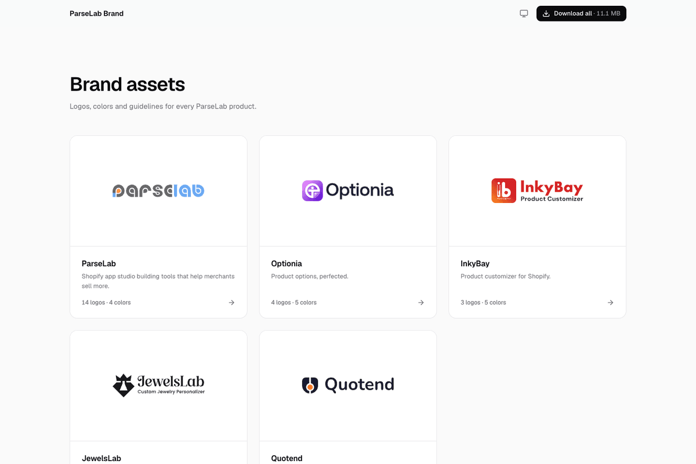
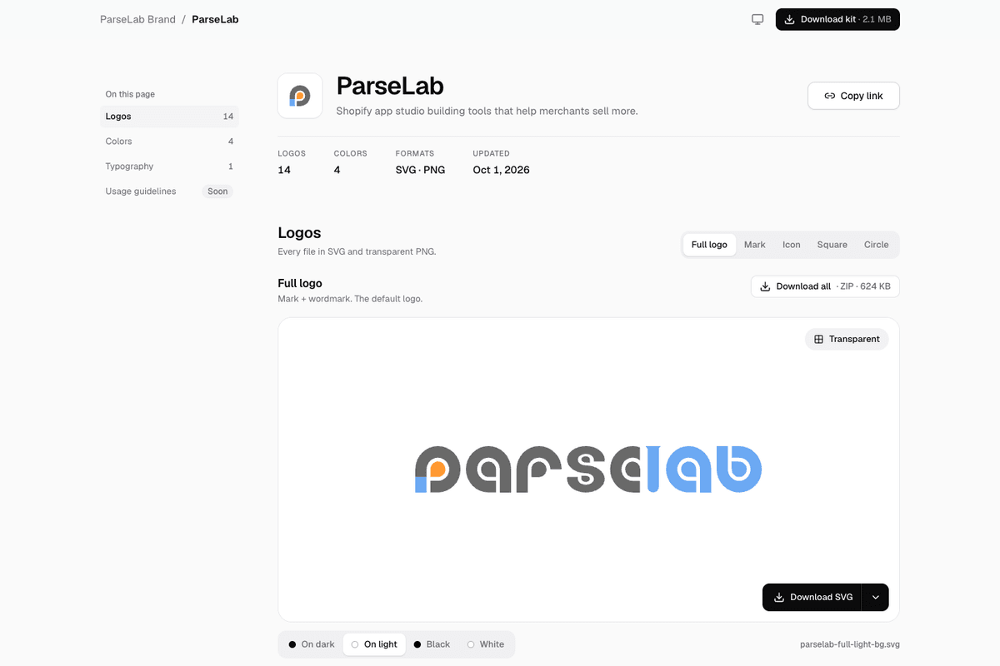

<p align="center">
  <a href="https://parselab-brand.vercel.app">
    <picture>
      <source media="(prefers-color-scheme: dark)" srcset="prisma/seed-data/brands/parselab/logos/full-dark-bg.svg">
      
    </picture>
  </a>
</p>

<h1 align="center">Brand Assets</h1>

<p align="center">
  Logos, colors, typography and usage guidelines for every ParseLab product, in one place,<br>
  with a private admin panel to keep them up to date.
</p>

<p align="center">
  <a href="https://parselab-brand.vercel.app"><strong>Live site</strong></a> ·
  <a href="https://parselab-brand.vercel.app/admin/">Admin</a> ·
  <a href="DEPLOY.md">Deploy guide</a>
</p>

<p align="center">
  
  
  
  
  
</p>

<p align="center">
  <picture>
    <source media="(prefers-color-scheme: dark)" srcset="docs/screenshots/home-dark.png">
    
  </picture>
  <picture>
    <source media="(prefers-color-scheme: dark)" srcset="docs/screenshots/brand-dark.png">
    
  </picture>
</p>

## Contents

- [What's inside](#whats-inside)
- [Tech stack](#tech-stack)
- [Getting started](#getting-started)
- [Project structure](#project-structure)
- [Admin guide](#admin-guide)
- [How it works](#how-it-works)
- [Sharing and shortcuts](#sharing-and-shortcuts)
- [Scripts](#scripts)
- [Testing](#testing)
- [Deploying](#deploying)
- [Seed data](#seed-data)

## What's inside

**Public site**: no sign-in needed.

- **Home** (`/`): a card for every published brand, and **Download all** (every brand kit in one ZIP).
- **Brand pages** (`/<slug>/`, e.g. [`/parselab/`](https://parselab-brand.vercel.app/parselab/)), each with four sections:
  - **Logos:** every variant previewed on its own background, as SVG or PNG (512 to 4096 px).
  - **Colors:** click to copy HEX, RGB or HSL, with `colors.css` and `colors.json` downloads.
  - **Typography:** typefaces in the real fonts, with the type scale.
  - **Usage guidelines:** written guidance plus Do / Don't examples.
- **Brand kit:** everything above in one ZIP per brand.
- Light, dark and system themes; works on phones; keyboard accessible.

**Admin panel** (`/admin/`): private, one admin account.

- Create, duplicate, reorder, publish and delete brands.
- Upload logos (SVG or PNG). Each one is checked, cleaned and turned into PNGs automatically.
- Edit colors, typography and usage guidelines, with live previews.
- Brand kits and "Download all" rebuild themselves after every change, or you can upload your own.
- Site settings: home page texts, footer and contact email.

The brands today: ParseLab, Optionia, InkyBay, JewelsLab and Quotend.

## Tech stack

| | |
| --- | --- |
| **Framework** | [Next.js 16](https://nextjs.org) (App Router, Cache Components), React 19, TypeScript |
| **Styling** | Tailwind CSS 4; Geist and each brand's own fonts, self-hosted |
| **Data** | Supabase Postgres through Prisma 7 (row-level security on every table) |
| **Files** | Supabase Storage (public bucket `brand-assets`), served from its CDN |
| **Images** | sharp (PNG rendering), svgo (SVG optimization), DOMPurify (SVG sanitizing) |
| **Auth** | argon2id passwords, HMAC-stored session tokens, lockout after failed sign-ins |
| **Hosting** | Vercel (functions in Seoul, next to the database), with a daily keep-alive cron |
| **Tests** | End-to-end suites with Puppeteer against a real build |

## Getting started

You need Node.js 24, a Supabase project with a **public** storage bucket named `brand-assets`, and its connection details.

```sh
corepack enable                # once: provides pnpm
pnpm install                   # also generates the Prisma client
cp .env.example .env.local     # fill in the Supabase values and the admin login
pnpm db:migrate                # create the tables
pnpm db:seed                   # create the admin and import the brands in prisma/seed-data/
pnpm dev                       # http://localhost:3000
```

For the production build: `pnpm build && pnpm start`.

> [!IMPORTANT]
> `.env.local` is git-ignored and holds secrets. `SUPABASE_SERVICE_ROLE_KEY` is server-only: never give it a `NEXT_PUBLIC_` prefix.

## Project structure

```text
app/
  page.tsx, [brand]/          Public home and brand pages
  admin/                      Admin panel: sign-in, brands, editors, settings, account
  api/admin/                  JSON APIs behind the admin editors (session + same-origin checked)
  api/internal/rebuild/       Background zip rebuilds (server-to-server, CRON_SECRET)
  api/cron/keepalive/         Daily Vercel Cron that keeps Supabase awake
components/                   UI: public sections, shell, admin editors
lib/
  brands.ts                   The public site's only data layer (cached)
  auth/                       Sessions, passwords, throttling, origin and cron checks
  admin/                      Uploads, storage, rebuilds and each editor's operations
prisma/
  schema.prisma, migrations/  Database schema
  seed.ts, seed-data/         First import of the brands
proxy.ts                      Guards /admin and /api/admin before anything renders
scripts/                      Asset build, admin password reset, favicons, storage sweep
tests/e2e/                    End-to-end suites
```

## Admin guide

Sign in at [`/admin/`](https://parselab-brand.vercel.app/admin/). There's one admin, created by the seed; there's no sign-up and no way to add a second admin.

| Page | What you can do |
| --- | --- |
| **Brands** | Reorder by drag (or keyboard), change status, search, edit, duplicate, delete |
| **General** | Name, URL slug, tagline, status, accent color, brand icon, home card preview |
| **Logos** | Logo types and their variants; upload, replace, rename, reorder, remove |
| **Colors** | Solid colors or gradients, with CMYK and Pantone; drag to reorder |
| **Typography** | Up to 4 typefaces with weights, previewed in the real fonts |
| **Usage** | Markdown guidelines and Do / Don't image pairs |
| **Brand kit** | Auto (built from logos and colors) or your own uploaded ZIP |
| **Settings** | Home page texts, footer, contact email, the "Download all" ZIP |
| **Account** | Change email or password, see and sign out sessions |

**Statuses:** *Draft* is hidden (not on the home page, its URL is a 404); *Soon* and *Live* are public. New brands start as Draft.

<details>
<summary><strong>Brands and the General tab</strong></summary>

- **List:** drag the handle (or focus it, press Space, use the arrow keys, press Space) to set the home-page order; change status inline. The row menu has Edit, View page, Duplicate and Delete. Search and the status filter narrow the list; reordering needs the full list.
- **General tab:** name, URL slug (lowercase, unique, not a reserved word such as `admin` or `api`), tagline, status, accent color, brand icon, and a preview of the home card in both themes. Changing the slug can keep a redirect from the old URL; old URLs can be removed later. Unsaved changes show a save bar and ask before you leave.
- **Delete** (Danger zone or row menu) needs the brand's name typed exactly, and removes everything in its storage folder. **Duplicate** copies a brand, files included, as a Draft.
- Every save expires exactly the public pages it touched, so the site shows it on the next visit.

</details>

<details>
<summary><strong>Logos</strong></summary>

- **Logo types:** add a preset (Full logo, Mark, Icon, Square, Circle) or a custom one; rename it, describe it, drag to reorder (the public tabs follow), delete it (typing its name when it has files).
- **Variants:** each type is a 2×2 grid of On dark, On light, Black and White, plus optional Brand color and Dark tiles for icons and avatars. Drop or pick an SVG or PNG (up to 5 MB) per slot; Replace, Download, Remove.
- **What an upload becomes:** an SVG is sanitized and optimized, stored under its download name (`<brand>-<type>-<variant>.svg`, editable) and rendered to transparent PNGs at 512, 1024, 2048 and 4096 px. A PNG-only upload keeps the standard widths up to its own, and the public page offers "Download PNG" instead of SVG.
- After every change the type's ZIP, the brand kit and "Download all" rebuild in the background; the editor shows "Rebuilding…" until they're done.

</details>

<details>
<summary><strong>Colors</strong></summary>

- Add or edit a color in the side panel: role, name, and either **Solid** (picker or hex, 3 or 6 digits, `#` optional; optional CMYK and Pantone) or **Gradient** (angle and 2–5 stops). RGB and HSL are always calculated, never typed.
- Drag to reorder; a live preview shows the same cards as the public page.
- `colors.css` and `colors.json` are generated from the list on every change, and the brand kit is rebuilt to include them.

</details>

<details>
<summary><strong>Typography</strong></summary>

- "Show as Coming soon" (the default) or up to 4 typefaces: family, what it sets (headings, body or both), its role label, weights and where to get it. At least one typeface must set the headings and one the body text.
- Families are self-hosted, so the list is what [`lib/fonts.ts`](lib/fonts.ts) loads and [`lib/font-catalog.ts`](lib/font-catalog.ts) describes; adding one is a developer change to both. No monospace families.
- The type scale is shared by every brand ([`lib/typography.ts`](lib/typography.ts)) and previewed with the chosen faces.

</details>

<details>
<summary><strong>Usage guidelines</strong></summary>

- "Show as Coming soon" (the default), or written guidelines in Markdown (Write / Preview) plus up to 12 Do / Don't pairs. Each side has an image (SVG, PNG, JPEG or WebP, up to 5 MB) and a caption.
- The public page renders the Markdown safely: no raw HTML, no images from Markdown (only the uploaded Do / Don't ones), and links to other sites open in a new tab with `rel="noopener noreferrer"`.
- Images taken out of a pair are deleted from storage on save; duplicating a brand copies them.

</details>

<details>
<summary><strong>Brand kit and Settings</strong></summary>

- **Brand kit, Auto** (the default): rebuilt after every change to logos or colors. It holds `README.txt`, `svg/`, `png/<width>/` and, when the brand has colors, `colors.css` and `colors.json`. "Rebuild now" forces a rebuild.
- **Brand kit, Manual:** upload your own ZIP (up to 50 MB, straight to storage). Its content must really be a ZIP; it's saved as `<slug>-brand-kit.zip`. Switching back to Auto rebuilds the kit and deletes the uploaded one. Without a kit, the public "Download kit" button stays hidden.
- **Settings, site texts:** home title (also the home page's `<title>`), subtitle, footer text and contact email. Saving updates the public pages at once.
- **Settings, all-brands kit** (the home page's "Download all"): **Auto** zips every public brand's logos and colors, a folder per brand. **Manual** takes your own ZIP, saved as `parselab-brand-kits.zip`.

</details>

<details>
<summary><strong>Account and recovery</strong></summary>

- **Account** (`/admin/account/`): change email (needs the current password), change password (12+ characters; signs out every other session), see and sign out sessions.
- **Lost password:** `pnpm admin:reset -- --email you@example.com` asks for a new one in the terminal (hidden), sets it and signs out every session. There's deliberately no email-based reset.

</details>

## How it works

<details>
<summary><strong>Data and caching</strong></summary>

- Schema: [`prisma/schema.prisma`](prisma/schema.prisma). Migrations run over `DIRECT_URL`; the app uses the pooled `DATABASE_URL`.
- [`lib/brands.ts`](lib/brands.ts) is the public site's only data layer. Draft brands never leave it.
- Public pages are prerendered from the database and cached (`"use cache"`); an admin save expires exactly the pages it changed.
- Every table has row-level security on with no policies, so Supabase's public REST API can read and write nothing. New tables need `ENABLE ROW LEVEL SECURITY` in their migration.

</details>

<details>
<summary><strong>Uploads</strong></summary>

Files go straight from the browser to storage, never through the app server, so there's no 4.5 MB request limit:

1. `POST /api/admin/uploads/sign` checks the session, origin, declared type and size, then issues a signed URL for a server-generated `staging/<uuid>/` key and a single-use ticket honored for 2 minutes.
2. The browser `PUT`s the file to storage.
3. `POST /api/admin/uploads/complete` sniffs the real content and rejects SVGs with scripts, event handlers or `foreignObject`. It then sanitizes (DOMPurify, no external references), optimizes (svgo), stores the result under `brands/<id>/<kind>/<uuid>/<name>` and deletes the staged copy.

Stale tickets and their staged files are swept automatically. Stored files have a 1-hour cache lifetime. On Supabase's free plan the CDN isn't purged on delete, so a deleted file can stay reachable at its old (unguessable) URL for up to an hour.

</details>

<details>
<summary><strong>Background rebuilds</strong></summary>

- Every logo or color change marks the brand stale. After the response, `/api/internal/rebuild/` (server-only, `CRON_SECRET`) rebuilds each type's ZIP and the brand kit, expires the public cache, then deletes the old ZIPs once that request has finished.
- A public brand then queues "Download all" as its own request, so neither runs into the 60-second function limit.
- **Overlapping changes are safe:** a rebuild commits its ZIPs only if nothing changed while it ran; otherwise it deletes what it built and the newer rebuild wins. Each file is downloaded once per rebuild, 8 at a time.
- `pnpm storage:sweep` lists generated ZIPs nothing references (add `-- --delete` to remove them). It should find none.

</details>

<details>
<summary><strong>Security</strong></summary>

- `proxy.ts` checks the session for every `/admin/**` page and `/api/admin/**` call before anything renders; every page, action and route checks it again ([`lib/auth/session.ts`](lib/auth/session.ts)).
- **Sessions:** a random 32-byte token in an `HttpOnly`, `Secure`, `SameSite=Lax` `__Host-` cookie. The database stores only an HMAC of it (`SESSION_SECRET`). They last 7 days and renew while in use.
- **Sign-in:** five wrong passwords for one email from one IP lock that pair out for 15 minutes; errors never say whether the email exists.
- Admin APIs refuse cross-site requests; admin pages are `noindex`, can't be framed and aren't cached.
- The full checklist is in [DEPLOY.md](DEPLOY.md#security-checklist).

</details>

## Sharing and shortcuts

- **Deep links:** `/<brand>?logo=<groupKey>&variant=<variantId>` opens that logo, e.g. [`/parselab?logo=icon&variant=icon-white`](https://parselab-brand.vercel.app/parselab/?logo=icon&variant=icon-white). "Copy link" shares the logo you're looking at.
- **Section anchors:** `#logos`, `#colors`, `#typography`, `#usage`.
- **Theme:** the navbar toggle cycles Light → Dark → System (the default). The choice is saved in the browser and applied before first paint ([`lib/theme-script.ts`](lib/theme-script.ts)).
- **Keyboard:** arrow keys, Home and End move between tabs and through the download menu; Esc closes it. In the logo section, `T` toggles the transparency preview and `D` downloads the current SVG.

## Scripts

| Command | What it does |
| --- | --- |
| `pnpm dev` | Development server on port 3000 |
| `pnpm build` / `pnpm start` | Production build and server |
| `pnpm typecheck` | TypeScript check |
| `pnpm db:migrate` | Apply database migrations |
| `pnpm db:seed` | Create the admin and import the seed brands (safe to rerun) |
| `pnpm admin:reset -- --email …` | Set a new admin password from the terminal |
| `pnpm storage:sweep` | List (or `-- --delete`) unused generated ZIPs |
| `pnpm favicons` | Rebuild the favicons from the ParseLab mark |
| `pnpm assets` | Render the seed data's files (used by the seed) |
| `pnpm validate` | Check the seed data |

## Testing

The end-to-end suites run against a real build on port 4173 (`pnpm build && pnpm start -p 4173`), or any deployment with `BASE_URL=https://…`. Admin suites work on temporary brands and delete them afterwards.

| Command | Covers |
| --- | --- |
| `pnpm test:e2e` | Every page, file and download; theme, logo tabs, copy and downloads |
| `pnpm test:auth` | Guards, sign-in and lockout, account changes, sessions, `admin:reset` |
| `pnpm test:admin` | Brands list and General tab, upload checks, the upload API's security |
| `pnpm test:logos` | Uploads, rejections, PNG-only, renames, reordering, kit and "Download all" contents |
| `pnpm test:colors` | Hex shorthand, gradients, edits, reordering, the public cards, generated files |
| `pnpm test:typography` | Coming soon, publishing a typeface, the headings/body rule, weights |
| `pnpm test:usage` | Markdown, the safety rules, Do / Don't images, clean-up |
| `pnpm test:kit` | Auto kit contents, Rebuild now, a 20 MB manual ZIP, back to Auto |
| `pnpm test:settings` | Site texts everywhere, validation, "Download all" in both modes |
| `pnpm test:parity` | Pixel-compares every page in both themes against a reference build (`REF_URL`) |

`test:auth` and `test:settings` change real values during the run and always put them back. They need `ADMIN_EMAIL` and `ADMIN_PASSWORD` in `.env.local`.

## Deploying

The site runs on **Vercel** with **Supabase**, and every push to `main` deploys automatically. [DEPLOY.md](DEPLOY.md) covers the environment variables, database migrations, the daily keep-alive and the security checklist.

## Seed data

The seed imports brands into an empty database; after that, the admin panel is where brands are managed. `pnpm db:seed` ([`prisma/seed.ts`](prisma/seed.ts)):

- Creates the admin from `ADMIN_EMAIL` / `ADMIN_PASSWORD`, only if none exists yet.
- Imports every brand in `prisma/seed-data/brands/<slug>/` (`brand.json` plus `logos/*.svg`) that isn't in the database yet, with its files.
- Is idempotent: existing brands and settings are left alone, and files are matched by content hash.
- Refuses `NODE_ENV=production` unless you pass `--force`.

<details>
<summary><strong><code>brand.json</code> reference</strong></summary>

The schema lives in [`lib/schema.ts`](lib/schema.ts). Copy [`parselab/brand.json`](prisma/seed-data/brands/parselab/brand.json) as a starting point; [`optionia`](prisma/seed-data/brands/optionia/brand.json) shows a gradient color and [`inkybay`](prisma/seed-data/brands/inkybay/brand.json) the minimum for a `soon` brand.

| Field | Notes |
| --- | --- |
| `slug` | Lowercase kebab-case, equals the folder name. Used in URLs and filenames. |
| `name`, `description` | Shown in the hero and on the home card. |
| `status` | `live` or `soon`. |
| `order` | Optional position on the home page, lower first (default 100, ties by name). |
| `updatedAt` | `YYYY-MM-DD`. |
| `contact` | Email shown in the footer. |
| `ogLogo` | Optional variant id for the 1200×630 link-preview image, drawn on that variant's `previewBg`. Defaults to the first variant. |
| `logoGroups[]` | Any number of groups (`key`, `label`, `description`), each with any number of `variants`. |
| `variants[]` | `id` (unique within the brand; its suffix says what it's for, see below), `name` (switcher label, e.g. "On dark"), `file` (inside `logos/`), `previewBg` (canvas background), optional `dot` (swatch, defaults to `previewBg`), `usage` (one-line hint). |
| `palettes[]` | `name` + `colors[]`. A color is `name`, `role`, `hex` (optional `cmyk`, `pantone`; RGB and HSL are computed) or `name`, `role`, `gradient: { angle, stops: [{ hex, at }] }`. |
| `typography` | Optional `typefaces[]`: `family` (registered in [`lib/fonts.ts`](lib/fonts.ts)), `role`, `use` (`headings`, `body` or `both`), `weights`, `url`. |

Variant ids end in what they're made for: `-light-bg` (On light), `-dark-bg` (On dark), `-black`, `-white`; anything else (`icon-brand`, `square-dark`) is a self-contained tile. That drives the theme ([`lib/variants.ts`](lib/variants.ts)):

- **Home cards** show the Full logo's `-light-bg` variant in light mode (else `-black`) and its `-dark-bg` in dark mode (else `-white`). No Full logo: the same order on the Icon group. No logos: the brand name.
- **Logo preview** starts on On dark in dark mode and On light in light mode, until a variant is picked.
- The hero icon and favicon is the `icon-brand` variant (else the first variant, then the brand's initial).

Logos should use outlined paths: `<text>` renders with whatever fonts the build machine has. `pnpm assets` ([`scripts/build-assets.ts`](scripts/build-assets.ts)) renders the seed files into `.generated/assets/` (git-ignored) for the seed to upload.

</details>

---

<p align="center"><sub>© ParseLab LLC. Brand assets are for approved use only.</sub></p>
